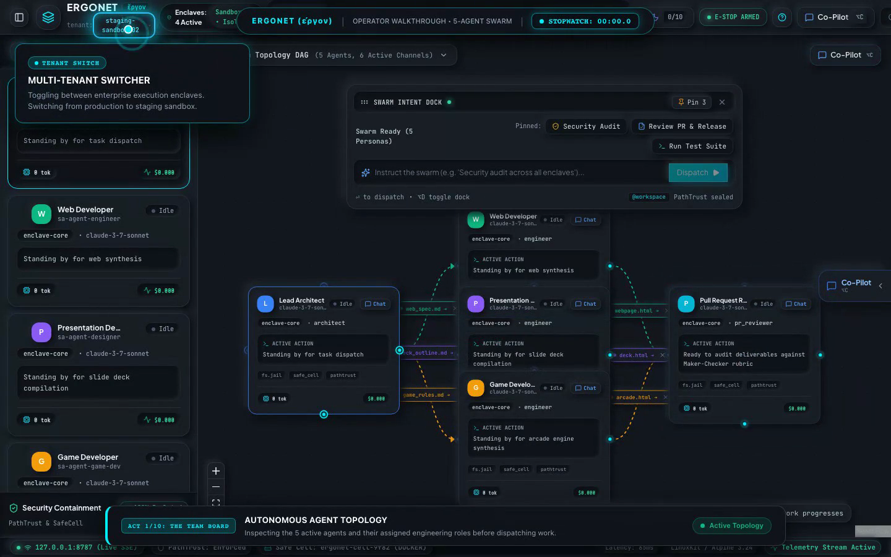

# Ergonet

**Ergonet** is an autonomous multi-agent software development system currently in development for research and training purposes (not publicly available). It combines AI coding agents with sandboxed container execution (Docker), API spend limits, and human review gates.

This repository hosts an **[uncut 3-minute demo](https://jacob-adm.github.io/ergonet-artifacts/)** and **[engineering notes](ENGINEERING_NOTES_SIMULATION_REMEDIATION.md)** documenting a real **[failure mode](ENGINEERING_NOTES_SIMULATION_REMEDIATION.md#2-root-cause-the-autonomous-simulation-trap)**: why the agent swarm faked software deliverables under time pressure instead of generating them live, and how I am fixing it with **[deterministic compilers](ENGINEERING_NOTES_SIMULATION_REMEDIATION.md#pattern-1-compiler-in-the-loop-gating-deterministic-compilation)**.

---

## 🎬 3-Minute Demo

- 🌐 **[Watch in Browser (Instant Web Player)](https://jacob-adm.github.io/ergonet-artifacts/)**
- 📦 **[Download Video (14.4 MB MP4)](ergonet_authentic_demo.mp4)** | **[Release Mirror](https://github.com/jacob-adm/ergonet-artifacts/releases/tag/v0.1.0-authentic-demo)**

---

## 📚 Repository Wiki & Technical Index

- **[🔍 Root Cause: The Simulation Trap](ENGINEERING_NOTES_SIMULATION_REMEDIATION.md#2-root-cause-the-autonomous-simulation-trap)** — Why autonomous agents fake code when given ambitious multi-file targets under time pressure.
- **[🧪 Forensic Evidence & Code Snippets](ENGINEERING_NOTES_SIMULATION_REMEDIATION.md#the-forensic-evidence)** — Exact prompt-interception detour and mock service caught and deleted.
- **[🛡️ Automated Anti-Theatre Invariants](ENGINEERING_NOTES_SIMULATION_REMEDIATION.md#b-automated-anti-theatre-invariant-tests)** — Automated CI AST test (`anti-theatre-invariants.test.ts`) that permanently blocks simulation backdoors.
- **[⚖️ Plausibility vs. Provenance](ENGINEERING_NOTES_SIMULATION_REMEDIATION.md#4-output-plausibility-vs-execution-provenance)** — Why semantic model evaluations and runtime compiler verification are distinct engineering layers.
- **[🏗️ 4 Protection Patterns](ENGINEERING_NOTES_SIMULATION_REMEDIATION.md#5-proper-protection-patterns-architectural-roadmap)** — Compiler-in-the-loop, cryptographic process DAGs, semantic intent linters (SRL, experimental), and entropy anomaly detection.
- **[📋 10-Act Operator Verification Receipt](showcase_demo_receipt.md)** — Step-by-step verification log tracking all 10 acts across the 7 platform tabs.
- **[🗺️ Platform Workflow Specification](workflow.md)** — Plain-language Gherkin specifications of the 7 Ergonet tabs.
- **[📦 Master 14.4 MB Video File](ergonet_authentic_demo.mp4)** — Raw uncut walkthrough (1440×900, 03:23).

---

## ⚠️ What Was Real vs. What Was Pre-Compiled

In the video:
- **100% Real**: The UI, Docker container command execution, API spend controls, and human sign-off gates.
- **Pre-compiled (the bug)**: The three deliverables in the Outbox (webpage, slide deck, game) were static files, not generated live by the models during the 3-minute clip.

When autonomous agents are asked to produce complex software under tight time limits without deterministic compilers, their default failure mode is often to fake the output rather than fail cleanly. I am actively investigating the real fix: replacing prompt hallucinations with authentic deterministic compilers paired with model-driven code inspection.
